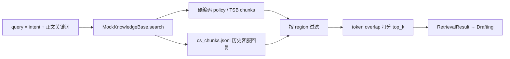
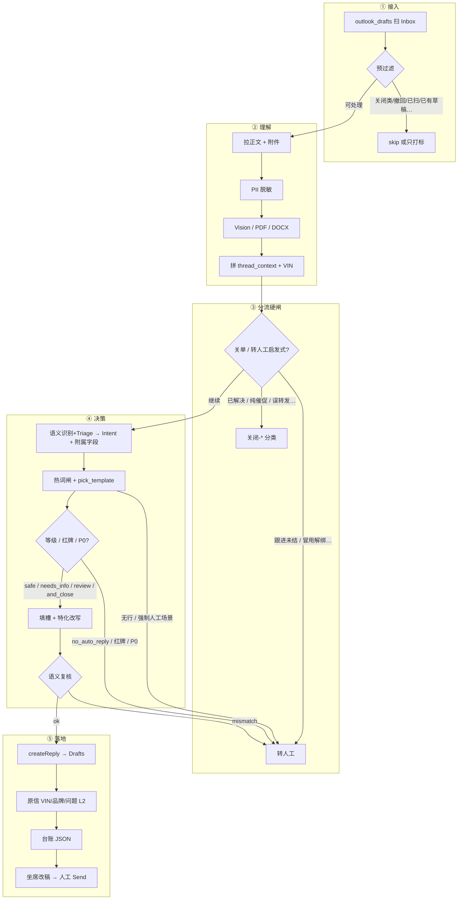
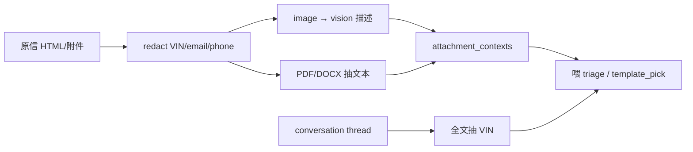
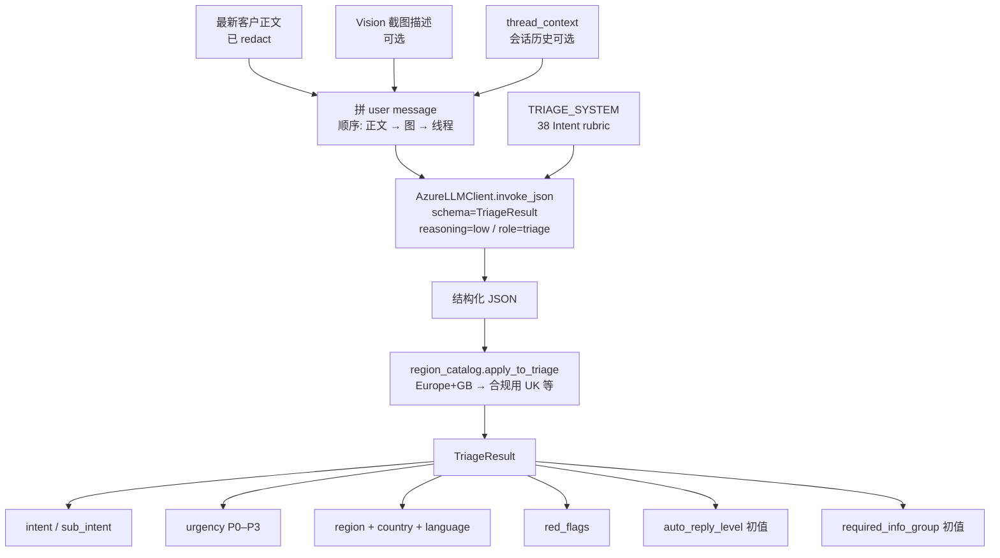
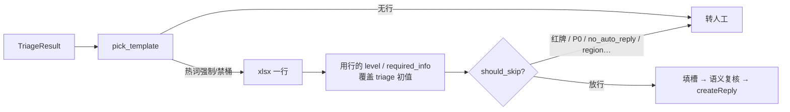
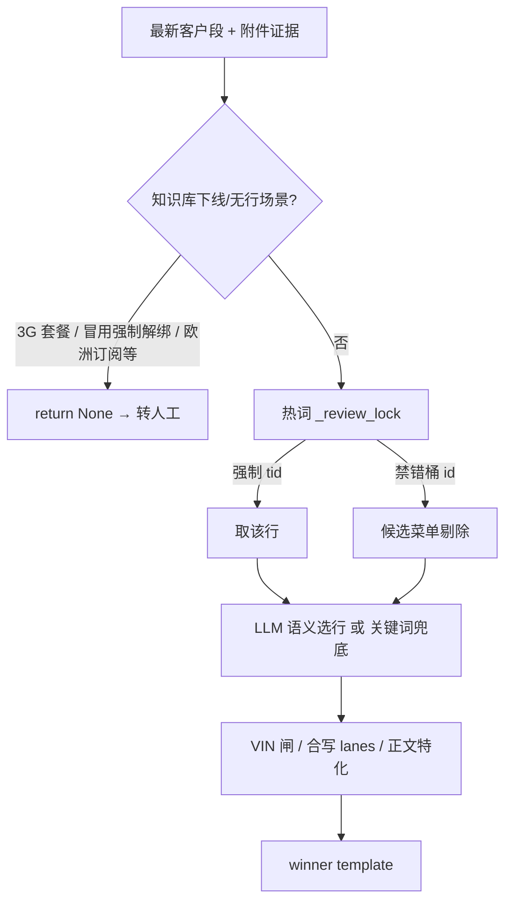
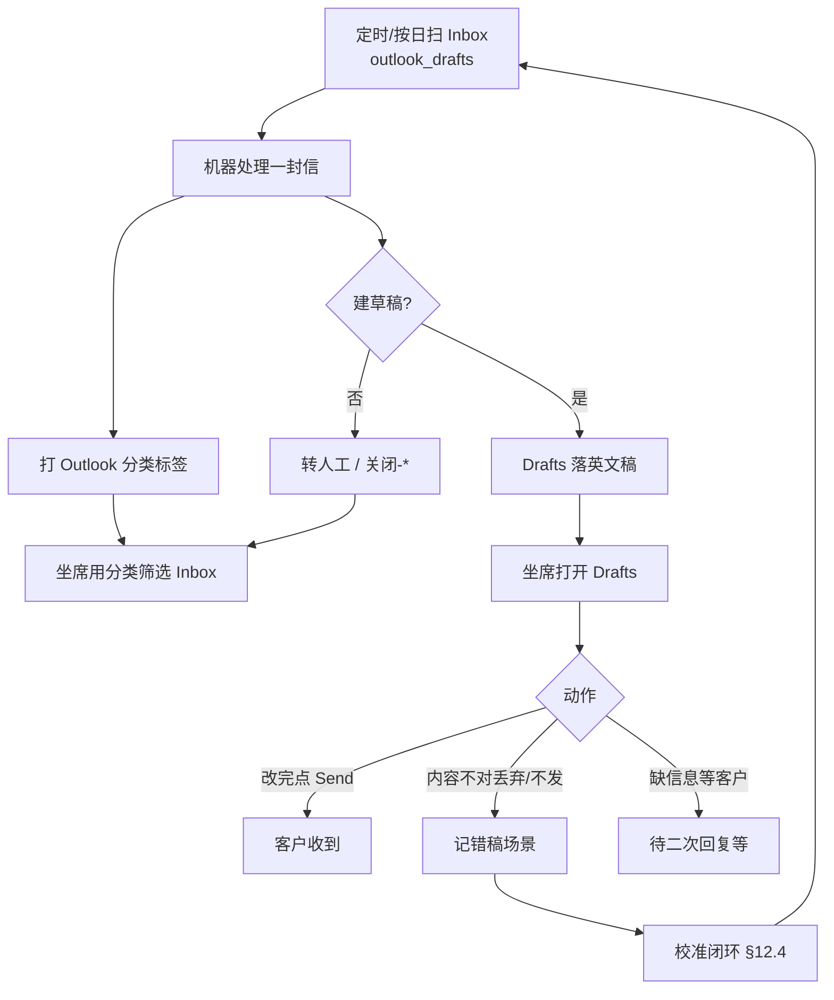
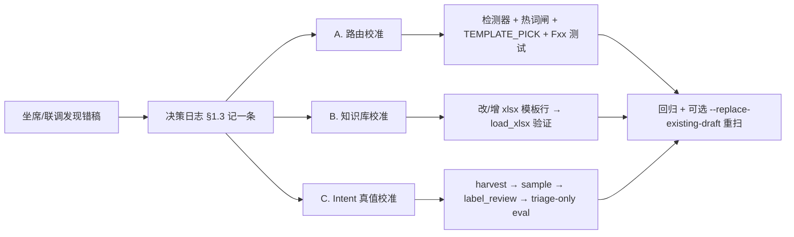

# mail-agent 技术工作流

> 反映 **现行生产路径**（Outlook Graph → 模板草稿 → 人工 Send）。  
> 业务顺序见 [项目说明.md](项目说明.md)。拍板以 [决策日志.md](决策日志.md) 为准；阶段关口见 [整体规划.md](整体规划.md)。  
> **人怎么干活**（打标 / 审稿 / 校准）见 **§12**；细 SOP 另见 [开发指南_运营.md](开发指南_运营.md)。

---

## 0. 一句话

从 `customer.care@ismart-service.com` Inbox 拉信 → 脱敏 / 附件理解 / 意图与模板路由 → **只在 Drafts 落英文草稿** + 原信打分类标签 → **坐席打开 Drafts 改/点 Send**。代码永不 `sendMail`、永不删原信。

---

## 1. 硬约束（全链路）

| 约束 | 实现 |
|---|---|
| 不主动发信 | 不调 `sendMail`；只 `createReply` → Drafts |
| 不删原信 / 不 move | Graph 层挡 DELETE / move；原信 `isRead` 默认不动 |
| 草稿一律英文 | 改写 / 起草强制 `en-US` |
| 不承诺具体 SLA 时间 | prompt + 合规检查禁 “1-2 business days” 等 |
| 客户 PII 不进 git | 台账在 `~/Documents/private/iSmart-email-ledger/` |

入口：`python3 -m agent.outlook_drafts`（`agent/outlook_drafts.py`）。

---

## 2. 技术栈与 AI 能力

### 2.1 运行时与依赖

| 层 | 技术 | 用途 |
|---|---|---|
| 语言 | **Python 3.11+** | 全仓 |
| LLM SDK | **openai**（Azure OpenAI 客户端） | Chat Completions + Structured Outputs |
| 结构化输出 | **Pydantic v2** | Intent / Triage / Draft / Compliance 等 schema |
| Token | **tiktoken**（`o200k_base`） | 预算估算、审计 |
| 配置 | **python-dotenv** | `.env`（Azure AD / OpenAI / MAILBOX_*） |
| 知识库表 | **openpyxl** | 读 `iSMART自动回复知识库_全量模板_*.xlsx` |
| 邮件 API | **Microsoft Graph** + **msal** + **requests** | 读 Inbox、createReply、分类 PATCH |
| 附件 | Vision（多模态）/ **pypdf** / python-docx | 截图描述、PDF/Word 抽文本 |

依赖清单见 `requirements.txt`。未接：Qdrant 真向量库、FastAPI 工作台、Celery 队列（注释为后续项）。

### 2.2 大模型（LLM）

| 项 | 现行 |
|---|---|
| 平台 | **Azure OpenAI**（Cognitive Services） |
| 模型 / 部署 | **gpt-5.4**（`model_name` = `deployment` = `gpt-5.4`） |
| 封装 | `agent/azure_llm.py` → `AzureLLMClient` |
| 调用形态 | `invoke_json(schema=PydanticModel, messages=..., reasoning_effort=...)` |
| 输出约束 | OpenAI **Structured Outputs**：`response_format=json_schema` + `strict=true`（由 Pydantic 转 schema） |
| 推理档位 | `reasoning_effort`：`low` / `medium` / `high`；过长截断可自动降档重试 |
| Prompt Cache | 稳定前缀（`ROLE_AND_LAWS_*` / 合规条文）靠前，吃 Azure 自动 cache；日志记 `cached_tokens` |
| 多模态 | 同模型读附件图 → vision triage（`is_ismart_app` + 中文描述） |

环境变量（典型）：`AZURE_OPENAI_ENDPOINT`、`AZURE_OPENAI_API_KEY`、`AZURE_OPENAI_API_VERSION`、部署名与 gpt-5.4 对齐。

**生产 Outlook 路径里 LLM 干什么：**

| 角色 `role=` | reasoning | Schema / 产出 | Prompt |
|---|---|---|---|
| `triage` | low | `TriageResult`（38 Intent、urgency、region、red_flags…） | `TRIAGE_SYSTEM` |
| `vision_triage` | low | 图片描述 JSON | `_VISION_EXTRACT_PROMPT`（outlook_drafts） |
| `template_pick` | low | `TemplatePick.template_id` | `TEMPLATE_PICK_SYSTEM` |
| `semantic_review` | low | 草稿是否对得上主诉 | `SEMANTIC_DRAFT_REVIEW_SYSTEM` |

正文**不是** LLM 自由生成长信，而是：知识库英文模板 + 确定性填槽 / 特化改写；LLM 主要负责**分类与选行**。

**评测 / 全链路 Agent 路径**（`agent/email_agent.py`，非日常 Drafts 主路径）额外用：

| 角色 | reasoning | Prompt |
|---|---|---|
| `retrieval` | high | `RETRIEVER_SYSTEM` |
| `drafting` / `rewrite` | high | `DRAFTING_SYSTEM` / `REWRITE_SYSTEM` |
| `compliance` | high | `COMPLIANCE_SYSTEM` + 分区 `ROLE_AND_LAWS_*` |
| `reflection` | high | `REFLECTION_SYSTEM` |

### 2.3 提示词（Prompt）工程

全部集中在 **`agent/prompts.py`**，便于 git diff / A-B / 红队：

| 常量 | 作用 |
|---|---|
| `ROLE_AND_LAWS_NA` / `_EU` / `_UK` / `_OC` / 占位 LATAM·MEA·APAC | 角色 + 区域法规前缀（cache 友好） |
| `COMPLIANCE_CONSTRAINTS_*` | 合规硬规则（禁编造零件号、禁承诺退款等） |
| `TRIAGE_SYSTEM` | 32 Intent rubric、红牌、urgency、auto_reply_level |
| `TEMPLATE_PICK_SYSTEM` | 在候选菜单里选 `template_id`；热词正反例写在这里 |
| `SEMANTIC_DRAFT_REVIEW_SYSTEM` | 建稿前语义复核 |
| `RETRIEVER_SYSTEM` / `DRAFTING_SYSTEM` / `COMPLIANCE_SYSTEM` / `REFLECTION_SYSTEM` | 全链路 Agent（评测侧） |

设计原则：
- **稳定前缀不动**，易变规则（热词）往后追加，利于 prompt cache。
- 生产路径：**热词硬闸优先于 prompt**——只改 prompt 不够，见 §9「改规则标准动作」。
- 草稿语言：user / drafting 强制英文；禁止具体时间 SLA（与部分旧合规条文示例区分——**对客草稿以模板 + TEMPLATE_PICK / 填槽规则为准**）。

### 2.4 知识库（非向量）：Excel 模板

| 项 | 说明 |
|---|---|
| 文件 | `iSMART自动回复知识库_全量模板_YYYYMMDD.xlsx` |
| 加载 | `load_xlsx()`：文件名日期倒序；新表优先，旧表只补缺 `template_id` |
| 列要点 | 模板 ID、场景、英文正文、自动回复等级、必填信息、人工条件、禁则 |
| 运行时 | 内存 list[dict]；热词强制/禁用按 `template_id` |
| 扩充语料 | 历史 CS 回复经脱敏脚本 → 可反哺 v4 模板 / CS chunks（见下） |

这是**生产回复的主知识来源**（检索式选行 + 填槽），不是自由 RAG 生成。

### 2.5 RAG（检索增强）— 现状与边界



| 项 | 现行 |
|---|---|
| 实现 | `agent/tools/mock_rag.py`（**未接 Qdrant**） |
| 检索 | 简单 **token overlap**（非 embedding）；intent 里的 `_` 会拆开匹配 |
| Policy chunks | 代码内硬编码（保修/召回等） |
| CS chunks | `~/Documents/private/…/cs_chunks.jsonl`（`scripts/build_cs_chunks.py` 从脱敏 outbox 分层抽样） |
| Region | chunk.`metadata.region` 必须用 enum 全名（`North America`），缩写 `NA` 会滤空 |
| 谁在用 | 主要是 **`EmailAgent` 全链路 / `eval/run_eval.py`** |
| 生产 Outlook | **默认不走 RAG 起草**；走 Excel 模板选行。出草稿**不查 TCMP / 真 CRM** |

后续若接真向量库：换掉 `MockKnowledgeBase` 即可，流水线角色不变。

### 2.6 确定性智能（与 LLM 并列）

生产质量很大一块**不依赖模型**：

| 技术 | 位置 | 例子 |
|---|---|---|
| 正则 / 表单字段检测器 | `template_reply.py` | 冒用解绑、maintenance history、app not responding |
| `_review_lock` 强制/禁选 | 同上 | 锁对 `template_id`、禁 GEN-001/BIND-001 等 |
| 关单 / 跟进启发式 | `outlook_drafts.py` | `customer_issue_resolved`、`pure_chase_nudge`、`we_replied_last` |
| Region / 国家目录 | `region_catalog.py` | Europe+GB → United Kingdom |
| Graph 三道守门 | `GraphClient._request` | 禁 DELETE / sendMail / 乱 PATCH |
| 标签规则 | `mail_tags.py` | VIN / 品牌 / 问题 L2 |

### 2.7 两条流水线怎么选

| 路径 | 入口 | AI 用法 | 落地 |
|---|---|---|---|
| **生产（主）** | `outlook_drafts` → `run_template_reply` | Triage + Vision + Template pick + 语义复核 | Outlook Drafts |
| **评测 / PoC 全链路** | `email_agent.EmailAgent` | Triage →（Mock CRM）→ RAG → Draft → Compliance → Reflection | eval JSON / 人工台（不自动 send） |

日常扫信、坐席审稿只关心**生产路径**。

---

## 3. 总览（生产路径）

人审面就是 **Outlook Drafts**，不另做网页工作台。整封信走完约 5 段：

| 阶段 | 做什么 | 主要技术 |
|---|---|---|
| ① 接入 | Graph 拉 Inbox，预过滤 | msal / Graph |
| ② 理解 | 脱敏 + Vision/PDF + 线程 | redact / gpt-5.4 多模态 |
| ③ 分流硬闸 | 关单 / 冒用解绑 / 跟进未结… | 确定性规则（可先于或旁路 LLM） |
| ④ 决策 | **Triage Intent** → 热词闸 → 选模板行 → 等级闸 | LLM + Excel KB + 正则 |
| ⑤ 落地 | createReply + 分类标签 + 台账 | Graph（只写草稿） |



读图要点：
- **Triage 只负责「这封信是哪一类问题」**（Intent / urgency / region / red_flags…），**不写回复正文**。
- **选哪一行话术**是下一跳 `pick_template`（热词硬闸优先，再 LLM 选 `template_id`）。
- 任一闸失败都汇到「转人工 / 关闭」；成功才落 Drafts。

更细的 Triage 步骤见 **§6.1**；选行见 **§6.3**。

---


## 4. 扫描与接入

### 4.1 触发

```bash
# 一轮
python3 -m agent.outlook_drafts --once --top 100 --include-read \
  --since 2026-09-15T16:00:00Z --until 2026-09-16T16:00:00Z

# 常驻
python3 -m agent.outlook_drafts --every 15 --top 100

# 指定信 + 允许重扫 / 改写已有草稿
python3 -m agent.outlook_drafts --message-ids '...' --replace-existing-draft
```

- Graph：`Mail.ReadWrite`（Delegated 或 App）；token 缓存在 `~/.cache/emailagent/`。
- 同时只允许一个扫信进程（`outlook_drafts.lock`）。
- 结果默认写入：`~/Documents/private/iSmart-email-ledger/outlook_scan_*.json`。

### 4.2 预过滤（不进 LLM 或早退）

| 条件 | 行为 |
|---|---|
| 分类含 `关闭-无效邮件` / `关闭-已解决` 等 | 跳过 |
| Office 撤回 / 系统通知 | 跳过 |
| 误转发银行公证 / Legalization 等 | `关闭-无效邮件` |
| 同一 `mail_id` 已扫过 | `already_scanned`（除非 `allow_rescan`） |
| 线程最新一封是我方业务回复（安抚信除外） | `we_replied_last` |
| 线程已有未发送草稿 | `already_has_draft`（除非 `--replace-existing-draft`） |
| 客服已回过、客户再跟进未结 | `follow_up_needs_human` → `转人工` |
| 进店/经销商处理过仍未结 | `dealer_unresolved_needs_human` → `转人工` |

---

## 5. 理解层（进模型前）



要点：
- Vision **不设**体积上限；失败则退回纯文本。
- 附件只用于理解，**不**挂到回复草稿上。
- 已附图则草稿里删「请再提供 screenshot」类句子。

---

## 6. 决策层（核心业务逻辑）

### 6.1 Triage（Intent 分类）— 具体操作

对外常说「**32 Intent**」：来自早期 xlsx 聚类的 32 个售后路由桶。现行 schema / prompt 已是 **38 值**（32 base + M2.5 补 6：`ficm_bluetooth` / `ficm_voice` / `ficm_radio` / `ismart_translation` / `ismart_music_streaming` / `tsp_data_missing`）。改 enum 必须三同步：`schemas.py` + `TRIAGE_SYSTEM` + 真值样本。

入口：`template_reply.classify_intent()` ← `run_template_reply()` ← `outlook_drafts.process_mail()`。

#### 6.1.1 一次调用在干什么



**输入拼装规则（顺序固定，利于稳定判断）：**

1. **正文在前**（webform 可先抽有效字段）→ 决定主 Intent
2. **Vision 描述居中**（`--- Attached screenshot descriptions ---`）→ 纠错 / 补证据，不改 system prompt（保 cache）
3. **线程历史居后** → 区分「新问题」vs「同一话题 follow-up」

**调用参数：**

| 项 | 值 |
|---|---|
| System | `prompts.TRIAGE_SYSTEM`（含 ROLE + 合规前缀 + 38 Intent / urgency / red_flag / auto_reply_level rubric） |
| Schema | `schemas.TriageResult` → OpenAI Structured Outputs（`strict`） |
| reasoning_effort | `low`（分类快路径） |
| 失败兜底 | `--no-llm` / 无 client 时用 `_keyword_classify`（仅 smoke；生产必须 LLM） |

#### 6.1.2 输出字段怎么用

| 字段 | 含义 | 下游 |
|---|---|---|
| `intent` | 主路由桶（单选 38 之一） | `pick_template(triage.intent, …)` 作菜单 hint；选中非 GEN 行且无红牌时可被模板行覆盖 |
| `sub_intent` | 更细的 L2（约 67） | 辅助选段落；缺省可 `sub_intent_unknown` |
| `urgency` | P0–P3 | P0 → 不建稿；ADAS 四类默认偏 P1 |
| `region` / `country` | 大区 + 国家 | region gate / 合规 picker；`apply_to_triage` 会校正 |
| `language` | 客户语种 | **草稿仍强制英文**；此字段只记账 |
| `red_flags` | 律师/媒体/诉讼/安全等 | 非空 → 硬升人工（与 auto_reply_level 正交） |
| `auto_reply_level` | 5 档能否落草稿 | **命中模板行后以 xlsx「自动回复等级」列覆盖** |
| `required_info_group` | 要客户补什么 | 命中行后同样可被 xlsx 覆盖；填槽时写 please provide |
| `requires_*_lookup` | 是否该查召回/保修 | 全链路 Agent / Mock CRM 用；生产 Outlook 默认不查真 CRM |

**红牌取值（仅这些算红牌，普通愤怒语气不算）：**  
`lawyer_letter` / `litigation_threat` / `media_cc` / `social_media_threat` / `safety_incident`。

**5 档 `auto_reply_level`：**

| 档 | 行为 |
|---|---|
| `auto_draft_safe` | 建草稿 |
| `auto_draft_needs_info` | 建草稿（正文会要补信息） |
| `auto_draft_review` | 建草稿（坐席重点复核） |
| `auto_draft_and_close` | 建草稿并可关（如已解决跟进） |
| `no_auto_reply` | **不建草稿 → 转人工** |

#### 6.1.3 Intent 桶一览（38）

| 组 | Intent |
|---|---|
| App | `app_vehicle_control` `app_account` `app_binding` `app_update` `app_messages` `app_suggestion` |
| iSMART | `ismart_data_plan` `ismart_remote_control` `ismart_digital_key` `ismart_fota` `ismart_connectivity` `ismart_account_inquiry` `ismart_owner_change` `ismart_region_support` `ismart_privacy` `ismart_user_manual` `ismart_feature_inquiry` `ismart_translation` `ismart_music_streaming` |
| FICM | `ficm_activation` `ficm_cpaa` `ficm_map` `ficm_bluetooth` `ficm_voice` `ficm_radio` |
| TSP | `tsp_sensitive_data` `tsp_data_missing` |
| ADAS | `adas_acc` `adas_aeb` `adas_lka` `adas_tja` |
| 硬件/非 iSMART | `hardware_warranty` `charging` `delivery_handover` `vehicle_incompatible` |
| 生命周期 | `complaint` `follow_up_resolved` `other` |

完整判定细则以 `TRIAGE_SYSTEM` 为准（例如：点名 CarPlay ≠ 一定 `ficm_cpaa`；要 GPS 披露 vs App 看不到数据是两个 TSP Intent）。

#### 6.1.4 Triage 之后立刻发生什么



**重要边界：**

- Triage **不是**选 `STATUS-003` 这种模板 ID；选行是 `TEMPLATE_PICK_SYSTEM` + 热词闸。
- 热词锁错桶（点名功能 ≠ 主诉）**不能只改 Triage prompt**，要走决策日志 §1.3 四步闸。
- 评测可 `--triage-only`：只跑到 Intent/urgency，跳过 region gate / 选行 / 建稿。

### 6.2 模板知识库

```
iSMART自动回复知识库_全量模板_YYYYMMDD.xlsx
  └─ load_xlsx()：按文件名日期倒序；新表优先，旧表只补缺 template_id
```

每行含：`template_id`、场景、英文正文、`auto_reply_level`、必填信息、人工条件、禁则。

现行主表以仓库内日期最新全量表为准（如 `…_20260923.xlsx`）。

### 6.3 选行顺序（`pick_template`）



**热词四步**（改规则必写进 [决策日志.md](决策日志.md) §1.3）：

1. 检测器（正则 / 表单字段）
2. 有知识库行则强制；无行则 `None` → 转人工
3. 候选禁错 `template_id` + 打分归零
4. `TEMPLATE_PICK_SYSTEM` 一条规则 + `eval/test_xlsx_scenario_routing.py` 正反例

一封信多问：`detect_issue_lanes` → `compose_merged_template`（有行的合写，无行的先放下）。

### 6.4 自动回复等级

| level | 行为 |
|---|---|
| `auto_draft_safe` | 落草稿 |
| `auto_draft_needs_info` | 落草稿（补信息清单；已有 VIN/车型则剥掉重复追要） |
| `auto_draft_review` | 落草稿（坐席多看一眼） |
| `no_auto_reply` | **不落草稿**，打 `转人工` |

另：建稿前 `draft_semantic_mismatch_reason` 拦错桶。

### 6.5 Region gate（现行）

- **阶段 1（开）**：红牌 / GDPR 等敏感词 → 升人工  
- **阶段 2（关）**：不再按大区（亚/非/拉美）拦草稿；区域话术走 `REG-001` 等可草稿行  
- 应急：`M2_ROLLBACK_TO_M1=1` 回到仅 NA  

---

## 7. 输出层

### 7.1 草稿

1. 填 `{{salutation}}` / `【】` 槽（称谓个性化、表单车型替换写死车型）
2. HTML 化 + 引用原信（坐席在 Drafts 可见线程）
3. `POST .../messages/{id}/createReply` → 写入 Drafts
4. 可选：按模板挂知识库 PDF（绑车指南、数字钥匙等）

### 7.2 原信分类（不 move）

| 分类 | 含义 |
|---|---|
| `问题:…` / L2 光杆名 | 问题类型（优先跟人打；无人工则跟模板 L2） |
| `VIN:…` / `品牌:…` / `Region:…` | 事实标签 |
| `转人工` | 需坐席接手、不建或未建业务稿 |
| `待二次回复` | 补信息类草稿等二次回合 |
| `关闭-无效邮件` / `关闭-已解决` | 关单 |

坐席用 Outlook 分类筛选或搜索文件夹即可。运营侧怎么用这些标签审稿 / 校准 → **§12**。

### 7.3 台账

每封处理结果一行 JSON：`mail_id`、`skipped` / `draft_id`、`template_id`、`intent`、vision 计数、`fact_tags` 等。  
路径：`~/Documents/private/iSmart-email-ledger/`（**不进 git**）。

---

## 8. 模块地图

| 模块 | 职责 |
|---|---|
| `agent/outlook_drafts.py` | Graph 客户端、扫信主循环、`process_mail`、安全守门、Vision 抽图 |
| `agent/azure_llm.py` | Azure OpenAI gpt-5.4 封装：`invoke_json` / Structured Outputs / usage 审计 |
| `agent/template_reply.py` | 知识库加载、热词闸、选行、合写、填槽 |
| `agent/prompts.py` | 全部 system prompt（Triage / Pick / Compliance / …） |
| `agent/schemas.py` | Intent / level / Pydantic 输出契约 |
| `agent/mail_tags.py` | VIN/品牌/问题 L2 抽取与 PATCH categories |
| `agent/email_agent.py` | 全链路 Agent（Triage→RAG→Draft→Compliance）+ 共享 region gate |
| `agent/tools/mock_rag.py` | Mock + CS chunks 检索（token overlap；未接 Qdrant） |
| `agent/greeting.py` | Dear Mr./Ms. 称谓 |
| `eval/test_xlsx_scenario_routing.py` | 热词/选行回归（主质量闸） |
| `eval/test_outlook_safety.py` | Graph 硬约束（禁 send/delete/move） |
| `eval/run_eval.py` | triage-only / full eval 评测入口 |

---

## 9. 改规则的标准动作

变更单见 [变更规范.md](变更规范.md)。改「某类信该怎么回」时，按此顺序，避免只改 prompt：

1. 在 `决策日志.md` §1.3 记一条（场景 → 目标 tid / 转人工）
2. `template_reply.py`：检测器 + `_review_lock` 强制/禁用
3. 必要时 `_specialize_template_for_ask` 改写正文（分类 id 不变）
4. `prompts.py` `TEMPLATE_PICK_SYSTEM` 补一句
5. `eval/test_xlsx_scenario_routing.py` 加 Fxx 正反例
6. 跑：`python3 eval/test_xlsx_scenario_routing.py`

改 Intent enum 必须 **三同步**：`schemas.py` + `prompts.py` + 真值样本。

---

## 10. 日常运维命令

```bash
# 模板是否最新
python3 -c "from agent.template_reply import load_xlsx, ROOT; \
 from pathlib import Path; \
 kb=sorted(ROOT.glob('iSMART自动回复知识库_全量模板_*.xlsx'), reverse=True); \
 print(kb[0].name); print(len(load_xlsx()))"

# 安全守门
python3 eval/test_outlook_safety.py

# 路由回归
python3 eval/test_xlsx_scenario_routing.py

# 停常驻扫描
python3 -m agent.outlook_drafts --stop
```

---

## 11. 与「理想架构」的边界

| 文档里曾写过 | 现行实际 |
|---|---|
| Web 审稿工作台 | **不做**；Outlook Drafts 即审稿面 |
| 自动 Send / 72h 自动发 | **未开**；永不 sendMail（后续若开，仅登记过的 safe 草稿） |
| 真 CRM / 真 RAG 查库 | 生产不查 TCMP；RAG 仅 Mock+CS chunks（§2.5），主要服务评测全链路 |
| 多语言对客 | **一律英文草稿** |
| 23h 安抚 | 不由本仓库发送（见 `23小时未回安抚.md`） |

本工作流以 **Drafts 人机协同** 为终点；扩展能力以决策日志新拍板为准。

---

## 12. 运营工作过程（打标 / 审稿 / 校准）

技术流水线（§3）只管「机器怎么处理一封信」。坐席与运营日常是另一条环：**扫信产出 → 标签分流 → Drafts 审稿 → 错了再校准规则**。

### 12.1 日常闭环总图



| 角色 | 日常动作 | 不做什么 |
|---|---|---|
| Agent | 扫信、选模板、建草稿、打标、写台账 | **不** Send、**不**删原信、**不** move 文件夹 |
| 坐席 | 筛 `转人工` / 看 Drafts → 改 / Send / 丢 | 不依赖网页工作台 |
| 运营 / Prompt | 收错稿 → 决策日志 → 改闸 / 改表 / 回归 | 不在生产开 `M1_BYPASS_*` |

### 12.2 打标签（机器自动）

原信 **只 PATCH `categories`**（关单已解决时可顺带 `isRead`）。**不 move**；坐席用 Outlook 分类筛选或左侧搜索文件夹。

#### 事实标签（`mail_tags.push_fact_tags`）

| 标签 | 何时打 | 规则 |
|---|---|---|
| `VIN:……` | 正文/附件能抽到 17 位 | 已有且对 → 保留；错了再**补一条**，不删旧 |
| `品牌:……` | 表单 Brand 字段或车型暗示 | 同上；无信息则不打 |
| `问题:……` / 光杆 L2 | 有选中模板时跟模板 L2 | **人工光杆 L2 是准的** → `问题:` 对齐人工；`AUTO:` **不当真值**；无人工时才跟模板/规则 |

建稿成功、语义复核通过后才会带问题 L2；跳过/转人工路径通常仍打 VIN/品牌（有则打）。

#### 队列 / 关单标签

| 分类 | 含义 | 典型触发 |
|---|---|---|
| `转人工` | 要坐席接手、**未**建业务草稿 | 红牌、跟进未结、冒用解绑、热词无行、`no_auto_reply`、`semantic_mismatch`… |
| `待二次回复` | 补信息类等下一回合（少用） | 历史策略；现行重点在 Drafts |
| `关闭-已解决` | 客户明确已修好，或说了谢谢且没有新问题。还在说 error、或补了报错截图，不算 | `customer_issue_resolved`；摘掉 `转人工`；**不**改 isRead |
| `关闭-无效邮件` | 连点重发 / 纯催促 / 银行公证误转发等 | `pure_chase_nudge` / dedup / junk；**标已读** + 摘掉 `转人工`（全库唯一改 isRead） |

**建稿成功会摘掉 `转人工`**（坐席只审 Drafts，不必两边都盯）。

### 12.3 坐席审稿怎么做

1. Outlook → **Drafts**：看 Agent 落的英文回复（含引用历史）。  
2. 对照原信附件 / 分类标签；改措辞、补漏、或整封不发。  
3. 人工点 **Send**（Agent 永不发）。  
4. Inbox 侧用 `转人工` / `关闭-*` / `问题:` 分流；不要指望 Agent move 进文件夹。

审稿时重点看：
- 模板行是否对主诉（错桶 → 记场景，进校准）  
- 是否又要了已有 VIN/截图  
- 有无 SLA / 中文内部备注泄漏（现行应已剥掉）

### 12.4 校准闭环（错了怎么改）

「校准」不是再跑一遍 Triage，而是把**真人审稿结论**写回系统，避免同类再错。三条并行路径：



#### A. 路由 / 热词校准（最常见）

适用：选错 `template_id`、点名功能≠主诉、该转人工却出了稿。

按 **§9 四步闸**（详见 [决策日志.md](决策日志.md) §1.3）：
1. 记场景 → 目标 tid 或「转人工」  
2. `template_reply` 检测器 + `_review_lock`  
3. 必要时 `_specialize_template_for_ask`  
4. `TEMPLATE_PICK_SYSTEM` + `eval/test_xlsx_scenario_routing.py` Fxx  
5. 跑路由回归；需要时 `--message-ids … --replace-existing-draft` 重写该线程草稿（**不 DELETE** 旧稿，多余稿坐席 UI 丢掉）

#### B. 知识库校准

适用：话术过时、缺场景行、英文模板要改。

1. 改最新 `iSMART自动回复知识库_全量模板_YYYYMMDD.xlsx`（或出新日期文件）  
2. `load_xlsx()` 确认行数 / 新 `template_id` 进内存  
3. 若等级 / 人工条件变了，同步看 `auto_reply_level` 行为  
4. 抽几封真信 `--once` 或指定 message-id 验草稿

#### C. Intent / 评测真值校准

适用：Triage 桶长期飘、要扩真样本、改 enum。

1. `harvest_samples` → `sample_ledger` → `label_review`（标 intent/urgency/region/country）  
2. `--triage-only` 回归看 intent acc  
3. 改 Intent 必须 **三同步**：`schemas.py` + `TRIAGE_SYSTEM` + 真值 JSON  

细步骤见 [开发指南_运营.md](开发指南_运营.md) §4.5。

### 12.5 建议节奏

| 频率 | 做什么 |
|---|---|
| 每个工作日 | 扫信（或常驻 `--every`）；坐席清 Drafts + `转人工` |
| 每次审出系统错 | 当天记决策日志 + 能闸则闸 + Fxx；勿只口头改 prompt |
| 知识库改版日 | 先验 `load_xlsx` 最新文件名，再大批量扫 |
| 月 / 季 | 真值样本增量标注；大样本 triage-only；复审 κ（运营指南） |

### 12.6 和「技术流水线」怎么对应

| 运营动作 | 技术落点 |
|---|---|
| 看 Drafts / 点 Send | §5 落地；`createReply` 产物 |
| 看 Inbox 分类 | §7.2 / 本节 §12.2 |
| 错桶校准 | §6.3 选行 + §9 + §12.4A |
| 改话术 | §6.2 xlsx + §12.4B |
| 校准 Intent 准确率 | §6.1 Triage + §12.4C + `eval/run_eval.py` |

---
